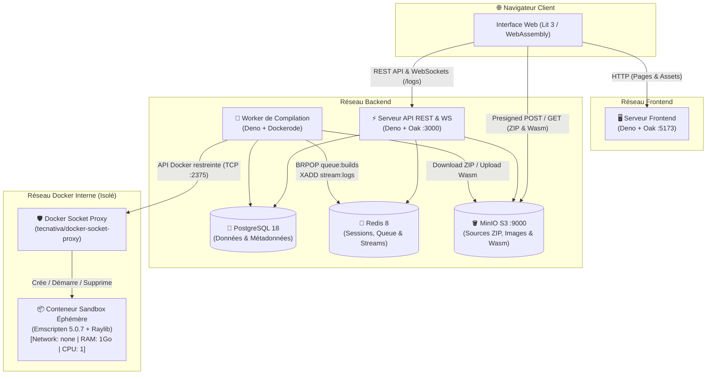
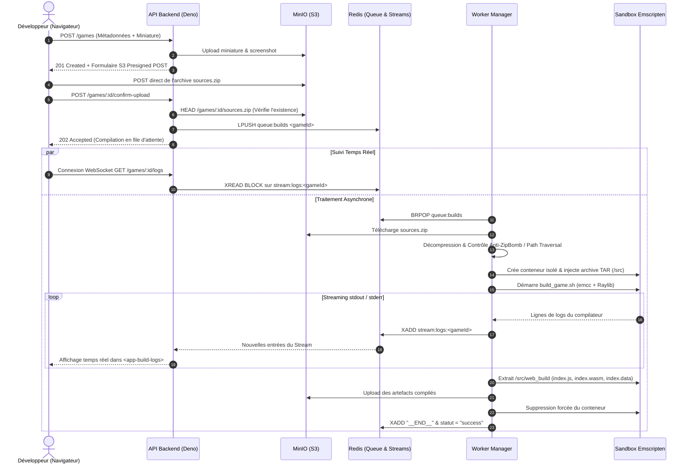

<div align="center">


# 🎮 RayDaMS

**La plateforme Cloud & WebAssembly pour compiler, partager et jouer aux
créations [Raylib](https://www.raylib.com/) directement dans votre navigateur.**

_Développée pour la filière **DaMS** (Data Science, Management & Software) de
**Polytech Montpellier** — Université de Montpellier._

---

<!-- Badges -->

[](https://github.com/La-Chaine-Du-Savoir/RayDaMS/stargazers)
[](https://github.com/La-Chaine-Du-Savoir/RayDaMS/network/members)
[](https://github.com/La-Chaine-Du-Savoir/RayDaMS/issues)
[](https://github.com/La-Chaine-Du-Savoir/RayDaMS/commits/main)
[](https://opensource.org/licenses/MIT)

<!-- Tech Stack Badges -->

[](https://deno.com/)
[](https://www.typescriptlang.org/)
[](https://lit.dev/)
[](https://webassembly.org/)
[](https://emscripten.org/)
[](https://www.raylib.com/)
[](https://www.postgresql.org/)
[](https://redis.io/)
[](https://min.io/)
[](https://www.docker.com/)

[À propos](#-à-propos-du-projet) • [Fonctionnalités](#-fonctionnalités-clés) • [Architecture](#️-architecture--flux-de-compilation) • [Installation](#-démarrage-rapide) • [Guide Raylib](#-guide--préparer-son-jeu-raylib) • [API](#-documentation-api) • [Contribuer](#-contribuer)

</div>

---

## 📋 Table des Matières

- [📖 À propos du projet](#-à-propos-du-projet)
- [✨ Fonctionnalités Clés](#-fonctionnalités-clés)
- [🏗️ Architecture & Flux de Compilation](#️-architecture--flux-de-compilation)
  - [Topologie Micro-services (Docker)](#topologie-micro-services-docker)
  - [Pipeline de Compilation Cloud vers WebAssembly](#pipeline-de-compilation-cloud-vers-webassembly)
  - [Sécurité & Défense en Profondeur](#sécurité--défense-en-profondeur)
- [🛠️ Stack Technique](#️-stack-technique)
- [📂 Structure du Dépôt](#-structure-du-dépôt)
- [🚀 Démarrage Rapide](#-démarrage-rapide)
  - [Prérequis](#prérequis)
  - [Installation & Lancement avec Docker](#installation--lancement-avec-docker)
  - [Variables d'Environnement](#variables-denvironnement)
- [📦 Guide : Préparer son jeu Raylib](#-guide--préparer-son-jeu-raylib)
- [💻 Commandes Utiles & Administration](#-commandes-utiles--administration)
- [🔌 Documentation API](#-documentation-api)
- [🧪 Tests, Qualité de Code & CI/CD](#-tests-qualité-de-code--cicd)
- [🤝 Contribuer](#-contribuer)
- [👥 Auteurs & Remerciements](#-auteurs--remerciements)
- [📄 Licence](#-licence)

---

## 📖 À propos du projet

**RayDaMS** est une plateforme web complète conçue pour permettre aux étudiants
et développeurs de publier leurs jeux écrits en **C avec la bibliothèque
[Raylib](https://www.raylib.com/)** et de les rendre jouables instantanément
dans n'importe quel navigateur web moderne, sans aucune installation requise
côté joueur.

Au lieu d'obliger chaque développeur à configurer localement une chaîne de
compilation croisée complexe (Emscripten SDK), **RayDaMS automatise
l'intégralité du processus dans le Cloud** :

1. L'utilisateur dépose simplement une archive `.zip` contenant son code source
   C et ses ressources (`assets/`).
2. Un **Worker asynchrone** orchestre à la volée un conteneur Docker éphémère,
   strictement isolé (sandboxé), qui compile le projet en **WebAssembly
   (`.wasm`, `.js`, `.data`)** via `emcc`.
3. Les logs de compilation sont diffusés **en temps réel** dans un terminal web
   interactif via **Redis Streams et WebSockets**.
4. Une fois compilé, le jeu est stocké sur un serveur compatible S3 (**MinIO**)
   et exécuté directement dans le navigateur avec support du plein écran et
   verrouillage du pointeur souris.

---

## ✨ Fonctionnalités Clés

- 🎮 **Lecteur WebAssembly Intégré (`<game-player>`)** : Exécution fluide à 60
  FPS dans un `<canvas>` HTML5, barre de progression de chargement des assets,
  mode plein écran natif (`F11`), gestion du _Pointer Lock_ et prévention du
  défilement clavier accidentel.
- ⚙️ **Compilation Cloud Automatisée** : Compilation transparente des sources
  `.c`, des en-têtes (`include/`, `lib/`) et empaquetage automatique du dossier
  `assets/` dans le système de fichiers virtuel Emscripten (`--preload-file`).
- 📡 **Streaming des Logs en Temps Réel (`<app-build-logs>`)** : Suivi en direct
  de la sortie standard (`stdout`/`stderr`) du compilateur `emcc` via WebSockets
  et Redis Streams (`XADD` / `XREAD BLOCK`), sans perte d'historique en cas de
  reconnexion.
- 👥 **Gestion de Groupes & Projets Collaboratifs** : Organisation des jeux par
  groupes de projet, génération de codes d'invitation uniques à 10 caractères
  (`nanoid`), et gestion fine des droits d'édition (auteur, membres du groupe,
  administrateurs).
- ☁️ **Stockage Objet S3 & Téléversement Direct** : Utilisation d'URLs et
  formulaires POST pré-signés (**S3 Presigned POST**) permettant au navigateur
  d'envoyer les archives volumineuses (jusqu'à 700 Mo) directement vers MinIO
  sans saturer l'API.
- 🔐 **Authentification Robuste & Gestion des Rôles** : Système complet à double
  jeton (JWT `HS512` court terme + _Refresh Token_ avec rotation atomique et
  verrou distribué Redis) stockés en cookies `HttpOnly`, et hachage des mots de
  passe combinant **HMAC-SHA256 (Poivre) + Bcrypt (Sel)**.

---

## 🏗️ Architecture & Flux de Compilation

### Topologie Micro-services (Docker)

L'application repose sur une architecture conteneurisée découpée en **3 réseaux
isolés** (`frontend-network`, `backend-network`, et un réseau interne
`docker-network`) :



### Pipeline de Compilation Cloud vers WebAssembly

Voici le cycle de vie complet lors de la publication d'un jeu sur RayDaMS :



### Sécurité & Défense en Profondeur

La compilation de code C arbitraire soumis par des utilisateurs présente des
risques critiques. RayDaMS implémente plusieurs verrous de sécurité :

| Couche                            | Mesure de Protection                                                             | Implémentation Technique                                                                                                                                     |
| :-------------------------------- | :------------------------------------------------------------------------------- | :----------------------------------------------------------------------------------------------------------------------------------------------------------- |
| **Isolation Réseau & Matérielle** | Conteneur de compilation totalement coupé d'Internet et limité en ressources.    | `NetworkMode: "none"`, `Memory: 1 Go`, `NanoCpus: 1 CPU`, `ulimit -f 512000` et timeout global (`BUILD_TIMEOUT_MS`).                                         |
| **Protection du Socket Docker**   | Le Worker n'a pas d'accès direct à `/var/run/docker.sock` en écriture.           | Passage par `tecnativa/docker-socket-proxy` monté en lecture seule (`:ro`), n'autorisant que `CONTAINERS`, `POST`, `DELETE` et `PING` sur un réseau interne. |
| **Sécurité des Archives ZIP**     | Protection contre les _Zip Bombs_ et les attaques _Path Traversal_ (`../`).      | Décompression en mémoire contrôlée avec rejet immédiat si la taille décompressée excède **700 Mo** ou si un chemin contient `..`.                            |
| **Conteneurs Non-Root**           | Aucun service applicatif ni compilateur ne tourne en tant que `root`.            | Utilisateur dédié `appuser:appgroup` sur les images `backend`, `frontend` et `compiler`.                                                                     |
| **Cryptographie & Sessions**      | Protection des mots de passe et prévention des _Race Conditions_ sur les tokens. | Poivrage `HMAC-SHA256` + `bcrypt`, cookies `HttpOnly`, rotation des _Refresh Tokens_ protégée par un verrou distribué Redis (`SET NX EX 5`).                 |

---

## 🛠️ Stack Technique

- **Runtime & Langage** : [Deno 2.7](https://deno.com/) (TypeScript natif,
  gestionnaire de workspaces et de permissions granulaire).
- **Backend API** : Framework [Oak](https://deno.land/x/oak), validation de
  schémas [Zod](https://zod.dev/), authentification
  [djwt](https://deno.land/x/djwt).
- **Worker & Compilation** : [Dockerode](https://github.com/apocas/dockerode),
  [fflate](https://github.com/101arrowz/fflate) (ZIP),
  [tar-stream](https://github.com/mafintosh/tar-stream),
  [Emscripten SDK 5.0.7](https://emscripten.org/) et
  [Raylib](https://github.com/raysan5/raylib).
- **Frontend** : Web Components natifs avec [Lit 3](https://lit.dev/), client
  HTTP [Axios](https://axios-http.com/) (avec intercepteur de rafraîchissement
  automatique du token), CSS personnalisé et police pixel-art _Grixel_.
- **Bases de données & Stockage** :
  - **PostgreSQL 18** : Utilisateurs, rôles, groupes, métadonnées des jeux et
    suivi des migrations.
  - **Redis 8** : Sessions JWT/Refresh, file d'attente de builds
    (`LPUSH`/`BRPOP`) et diffusion de logs (`Redis Streams`).
  - **MinIO (S3)** : Stockage objet haute performance pour les avatars,
    miniatures, archives sources et binaires WebAssembly.

---

## 📂 Structure du Dépôt

```text
RayDaMS/
├── backend/                        # Workspace Deno — Serveur API & Worker de compilation
│   ├── migrations/                 # Migrations SQL séquentielles (PostgreSQL)
│   ├── src/
│   │   ├── Commands/               # Scripts CLI (migrate, populate, prune, createAdmin)
│   │   ├── Config/                 # Lecture et validation de la configuration (.env)
│   │   ├── Middlewares/            # Middlewares Oak (Auth JWT, RBAC Admin, FormData)
│   │   ├── Model/                  # DataObjects & Repositories (Users, Groups, Games)
│   │   ├── Routes/                 # Contrôleurs REST & WebSocket (Auth, Users, Groups, Games)
│   │   ├── Services/               # Clients PostgreSQL, Redis, MinIO S3 & Password Service
│   │   ├── back_server.ts          # Point d'entrée de l'API REST
│   │   └── worker_manager.ts       # Point d'entrée du démon Worker de compilation Wasm
│   ├── tests/                      # Tests unitaires et d'intégration (Mocks Redis & Repo)
│   ├── Dockerfile                  # Image Docker de l'API et du Worker
│   └── deno.json                   # Dépendances et tâches Deno du backend
├── compiler/                       # Environnement de compilation C / Raylib -> WebAssembly
│   ├── Dockerfile                  # Image multi-stage (Emscripten 5.0.7 + compilation de libraylib.a)
│   └── build.sh                    # Script d'orchestration emcc exécuté dans la sandbox
├── frontend/                       # Workspace Deno — Serveur Frontend & Web Components
│   ├── src/
│   │   ├── pages/                  # Pages HTML (index, games, play, upload, groups, profile...)
│   │   ├── public/
│   │   │   ├── assets/             # Styles CSS, polices et logos
│   │   │   ├── components/         # Web Components Lit (<game-player>, <app-build-logs>, etc.)
│   │   │   ├── scripts/            # Logique métier par page
│   │   │   └── services/           # Client API Axios centralisé (apiService.js)
│   │   └── front_server.ts         # Serveur Oak avec injection dynamique de configuration
│   ├── Dockerfile                  # Image Docker du serveur frontend
│   └── deno.json                   # Configuration et tâches Deno du frontend
├── .githooks/                      # Hooks Git (pre-commit : formatage, lint et typage Deno)
├── .env.example                    # Modèle des variables d'environnement
├── .gitlab-ci.yml                  # Pipeline CI/CD (Lint, Test, Build multi-images, Deploy SSH)
├── deno.json                       # Déclaration du workspace global Deno
├── docker-compose.yml              # Orchestration complète pour le développement local
└── docker-compose.prod.yml         # Orchestration optimisée pour la production
```

---

## 🚀 Démarrage Rapide

### Prérequis

- [**Docker**](https://docs.docker.com/get-docker/) (v24+) et **Docker Compose**
  (v2+)
- [**Git**](https://git-scm.com/)
- _(Optionnel pour le développement hors conteneur)_
  [**Deno**](https://deno.com/) (v2.7+)

### Installation & Lancement avec Docker

1. **Cloner le dépôt** :
   ```bash
   git clone https://github.com/La-Chaine-Du-Savoir/RayDaMS.git
   cd RayDaMS
   ```

2. **Configurer les variables d'environnement** : Copiez le fichier d'exemple
   [`.env.example`](.env.example) vers `.env` à la racine du projet :
   ```bash
   cp .env.example .env
   ```
   > [!TIP]
   > Les valeurs par défaut de `.env.example` sont pré-configurées pour
   > fonctionner immédiatement en développement local. Pensez simplement à
   > définir des secrets robustes (`JWT_SECRET`, `PEPPER_SECRET`, mots de passe)
   > si vous exposez l'instance.

3. **Construire et démarrer l'ensemble des services** :
   ```bash
   docker compose up -d --build
   ```
   _Note : Lors du premier lancement, la construction de l'image `compiler`
   télécharge et compile le code source de Raylib avec Emscripten, ce qui peut
   prendre quelques minutes._

4. **(Optionnel) Peupler la base de données avec des données de test** : Les
   migrations SQL s'exécutent automatiquement au démarrage du conteneur `api`.
   Pour ajouter des comptes et groupes de démonstration :
   ```bash
   docker compose exec api deno task db:populate
   ```

5. **Accéder aux interfaces** :
   - 🎮 **Application Web (Frontend)** :
     [http://localhost:5173](http://localhost:5173)
   - ⚡ **API Backend** : [http://localhost:3000](http://localhost:3000)
   - 🪣 **Console MinIO (S3)** : [http://localhost:9001](http://localhost:9001)
     _(Identifiants définis dans `.env`)_

### Variables d'Environnement

Le tableau ci-dessous détaille les paramètres configurables dans le fichier
`.env` :

| Variable                              | Description                                                  | Valeur par défaut (Dev)                |
| :------------------------------------ | :----------------------------------------------------------- | :------------------------------------- |
| `DB_USER` / `DB_PASSWORD` / `DB_NAME` | Identifiants et nom de la base PostgreSQL                    | `myuser` / `mypassword` / `mydatabase` |
| `DB_HOST` / `DB_PORT`                 | Hôte et port PostgreSQL                                      | `db` / `5432`                          |
| `REDIS_PASSWORD`                      | Mot de passe du serveur Redis                                | `mypassword`                           |
| `MINIO_USER` / `MINIO_PASSWORD`       | Identifiants administrateur MinIO S3                         | `myuser` / `mypassword`                |
| `MINIO_STORAGE_BUCKET_NAME`           | Nom du bucket S3 initialisé automatiquement                  | `raydams`                              |
| `PUBLIC_S3_ENDPOINT`                  | URL publique de MinIO utilisée pour signer les URLs clientes | `http://localhost:9000`                |
| `JWT_SECRET`                          | Clé secrète HMAC-SHA512 pour signer les Access Tokens        | _À personnaliser_                      |
| `PEPPER_SECRET`                       | Clé secrète HMAC-SHA256 pour poivrer les mots de passe       | _À personnaliser_                      |
| `ACCESS_TOKEN_LIFETIME`               | Durée de vie du JWT d'accès (en secondes)                    | `900` (15 min)                         |
| `REFRESH_TOKEN_LIFETIME`              | Durée de vie du Refresh Token (en secondes)                  | `604800` (7 jours)                     |
| `COOKIE_SECURE` / `COOKIE_SAMESITE`   | Paramètres de sécurité des cookies HTTP                      | `false` / `lax`                        |
| `ALLOWED_ORIGINS`                     | Domaines autorisés par la politique CORS (séparés par `,`)   | `http://localhost:5173`                |
| `MAX_CONCURRENT`                      | Nombre maximal de compilations parallèles sur le Worker      | `2`                                    |
| `BUILD_TIMEOUT_MS`                    | Temps maximal alloué à une compilation (en ms)               | `300000` (5 min)                       |
| `API_URL`                             | URL de l'API injectée dans le Frontend                       | `http://localhost:3000`                |

---

## 📦 Guide : Préparer son jeu Raylib

Pour que votre jeu C / Raylib compile sans erreur sur **RayDaMS**, votre archive
`.zip` doit respecter quelques conventions simples prises en charge par le
script [`compiler/build.sh`](compiler/build.sh) :

### Structure recommandée de l'archive `.zip`

> [!NOTE]
> Que vous compressiez directement les fichiers ou le dossier parent (racine
> commune), le Worker détecte et aplatit automatiquement le dossier racine lors
> de l'extraction.

```text
mon-jeu-raylib.zip
├── src/                    # Vos fichiers sources .c (tous les .c du projet sont compilés automatiquement)
│   └── main.c
├── include/                # (Optionnel) Vos fichiers d'en-têtes .h (-Iinclude est ajouté automatiquement)
│   └── game.h
├── lib/                    # (Optionnel) Bibliothèques additionnelles (-Ilib est ajouté automatiquement)
└── assets/                 # (Optionnel) Vos textures, sons, polices, niveaux...
    ├── sprites/
    └── audio/
```

### Règles de compilation appliquées par la plateforme

1. **Détection automatique des sources** : Tous les fichiers `*.c` présents dans
   l'archive sont compilés ensemble. Aucun `Makefile` ou `CMakeLists.txt` n'est
   requis.
2. **Chemins d'inclusion (`Include Flags`)** : Les répertoires `.`, `./include`
   et `./lib` sont automatiquement ajoutés aux flags `-I` d'Emscripten, ainsi
   que les en-têtes officiels de Raylib (`raylib.h`, `raymath.h`, `rlgl.h`).
3. **Empaquetage des ressources (`assets/`)** : Si un dossier nommé exactement
   `assets` est présent à la racine de votre projet, il est automatiquement
   préchargé dans le système de fichiers virtuel WebAssembly
   (`--preload-file assets`). Dans votre code C, chargez vos fichiers avec des
   chemins relatifs tels que `LoadTexture("assets/sprites/player.png");`.
4. **Boucle principale & `ASYNCIFY`** : La compilation active le flag
   `-s ASYNCIFY` d'Emscripten. Ainsi, même une boucle Raylib standard
   `while (!WindowShouldClose()) { ... }` fonctionne directement dans le
   navigateur sans bloquer le thread principal !
5. **Limites** : L'archive décompressée ne doit pas dépasser **700 Mo**.

---

## 💻 Commandes Utiles & Administration

Toutes les commandes d'administration de la base de données sont centralisées
sous forme de tâches Deno dans [`backend/deno.json`](backend/deno.json). Vous
pouvez les exécuter directement dans le conteneur `api` :

| Commande (via Docker Compose)                                                                             | Description                                                                  |
| :-------------------------------------------------------------------------------------------------------- | :--------------------------------------------------------------------------- |
| `docker compose exec api deno task db:migrate`                                                            | Applique les migrations SQL en attente dans `backend/migrations/`.           |
| `docker compose exec api deno task db:populate`                                                           | Crée un jeu de données de démonstration (Uniquement hors production).        |
| `docker compose exec api deno task db:setup-dev`                                                          | Combine `db:migrate` puis `db:populate` en une seule étape.                  |
| `docker compose exec api deno task user:create-admin -- --username <nom> --email <mail> --password <mdp>` | Crée un nouvel utilisateur disposant des rôles `member` et `admin`.          |
| `docker compose exec -e CONFIRM_PRUNE=true api deno task db:prune`                                        | Vide toutes les tables de données tout en conservant le schéma et les rôles. |

> [!TIP]
> **Comptes de démonstration créés par `db:populate`** :
>
> - **Administrateurs** : `admin1` / `admin2` (Mot de passe : `Lapin12!`)
> - **Membres** : `Thib`, `Toine`, `Nosman` (Mot de passe : `Lapin12!`)
> - **Groupes & Codes d'invitation** : _Chaine du savoir_ (`SAVOIR0001`),
>   _Group2_ (`SKIBIDI001`), _Group3_ (`TDB0000001`).

---

## 🔌 Documentation API

Le serveur Backend expose une API RESTful et WebSocket sur le port `3000`.
L'authentification s'effectue via cookies `HttpOnly` (`access_token` et
`refresh_token`).

### 🔐 Authentification (`/auth`)

| Méthode | Endpoint              | Accès          | Description                                                                       |
| :------ | :-------------------- | :------------- | :-------------------------------------------------------------------------------- |
| `POST`  | `/auth/register`      | Public         | Inscription d'un nouvel utilisateur (`username`, `email`, `password`).            |
| `POST`  | `/auth/login`         | Public         | Connexion et émission des cookies `access_token` et `refresh_token`.              |
| `POST`  | `/auth/logout`        | Public         | Déconnexion, révocation du _Refresh Token_ dans Redis et suppression des cookies. |
| `POST`  | `/auth/token/refresh` | Cookie Refresh | Rotation atomique du _Refresh Token_ et renouvellement de l'_Access Token_.       |

### 👤 Utilisateurs (`/users`)

| Méthode | Endpoint             | Accès       | Description                                                                 |
| :------ | :------------------- | :---------- | :-------------------------------------------------------------------------- |
| `PATCH` | `/users/me`          | Authentifié | Mise à jour de l'email et/ou de l'avatar (`multipart/form-data`, max 5 Mo). |
| `PATCH` | `/users/me/password` | Authentifié | Modification du mot de passe (`oldPassword`, `newPassword`).                |
| `GET`   | `/users/:id/groups`  | Authentifié | Récupère la liste des groupes auxquels appartient l'utilisateur.            |

### 👥 Groupes (`/groups`)

| Méthode  | Endpoint                    | Accès       | Description                                                                          |
| :------- | :-------------------------- | :---------- | :----------------------------------------------------------------------------------- |
| `GET`    | `/groups`                   | Authentifié | Liste l'ensemble des groupes et leurs membres.                                       |
| `GET`    | `/groups/with-games`        | Authentifié | Liste tous les groupes avec leurs jeux associés et les droits d'édition (`canEdit`). |
| `GET`    | `/groups/:id`               | Authentifié | Détails complets d'un groupe, de ses membres et de ses jeux.                         |
| `GET`    | `/groups/:id/games`         | Authentifié | Liste uniquement les jeux rattachés à un groupe donné.                               |
| `POST`   | `/groups/join`              | Authentifié | Rejoindre un groupe via son code d'invitation à 10 caractères (`{ "code": "..." }`). |
| `POST`   | `/groups`                   | **Admin**   | Crée un nouveau groupe et génère automatiquement son code d'invitation.              |
| `PATCH`  | `/groups/:id`               | **Admin**   | Renomme un groupe existant.                                                          |
| `DELETE` | `/groups/:id/users/:userId` | **Admin**   | Retire un utilisateur d'un groupe.                                                   |
| `DELETE` | `/groups/:id`               | **Admin**   | Supprime un groupe et ses associations en cascade.                                   |

### 🎮 Jeux & Compilation (`/games`)

| Méthode    | Endpoint                        | Accès                    | Description                                                                                                       |
| :--------- | :------------------------------ | :----------------------- | :---------------------------------------------------------------------------------------------------------------- |
| `POST`     | `/games`                        | Membre du groupe / Admin | Crée la fiche d'un jeu (`multipart/form-data`) et retourne une requête S3 Presigned POST pour uploader le `.zip`. |
| `GET`      | `/games/:gameId`                | Authentifié              | Récupère les métadonnées d'un jeu et les URLs pré-signées de ses binaires Wasm.                                   |
| `PATCH`    | `/games/:gameId`                | Auteur / Admin           | Modifie les informations, la miniature ou la capture d'écran d'un jeu.                                            |
| `DELETE`   | `/games/:gameId`                | Auteur / Admin           | Supprime le jeu en base ainsi que tous ses fichiers sur MinIO S3.                                                 |
| `GET`      | `/games/:gameId/upload-request` | Auteur / Admin           | Nettoie un éventuel build précédent et génère une nouvelle URL pré-signée d'upload ZIP.                           |
| `POST`     | `/games/:gameId/confirm-upload` | Auteur / Admin           | Vérifie la présence du ZIP sur S3 et place le jeu dans la file de compilation Redis (`queue:builds`).             |
| `GET (WS)` | `/games/:gameId/logs`           | Auteur / Admin           | **WebSocket** : Diffuse en temps réel les logs de compilation depuis le stream Redis `stream:logs:<gameId>`.      |

---

## 🧪 Tests, Qualité de Code & CI/CD

### Exécuter les tests unitaires

Le backend dispose d'une suite de tests automatisés (authentification, hachage
et poivrage de mots de passe, middlewares de sécurité) utilisant des mocks en
mémoire pour Redis et les Repositories :

```bash
# Depuis le conteneur Docker
docker compose exec api deno task test

# Ou localement avec Deno installé
cd backend && deno task test
```

### Formateur, Linter & Hook de Pre-commit

Le projet utilise les outils standardisés de Deno (`deno fmt`, `deno lint`,
`deno check`). Un hook Git de **pre-commit** est fourni dans
[`.githooks/pre-commit`](.githooks/pre-commit) : il vérifie automatiquement dans
un conteneur Docker `denoland/deno:alpine-2.7.14` la conformité de tous les
fichiers modifiés avant chaque commit.

Pour activer le hook Git sur votre machine locale :

```bash
git config core.hooksPath .githooks
```

### Pipeline CI/CD

Le fichier [`.gitlab-ci.yml`](.gitlab-ci.yml) automatise 4 étapes :

1. **`lint`** : Vérification du formatage (`deno fmt --check`), du linter
   (`deno lint`) et du typage (`deno check`) sur les Merge Requests.
2. **`test`** : Exécution des tests unitaires backend avec génération de
   rapports JUnit.
3. **`build`** : Construction et publication des images Docker (`api`, `front`,
   `worker`) avec mise en cache des couches.
4. **`deploy`** : Déploiement continu automatisé en production via SSH et
   `docker-compose.prod.yml` lors des fusions sur la branche `main`.

---

## 🤝 Contribuer

Les contributions sont les bienvenues ! Pour proposer une amélioration ou
corriger un bug :

1. **Forkez** le dépôt sur GitHub.
2. Créez votre branche de fonctionnalité
   (`git checkout -b feat/ma-nouvelle-fonctionnalite`).
3. Activez les hooks de pre-commit (`git config core.hooksPath .githooks`).
4. Assurez-vous que les tests passent (`cd backend && deno task test`).
5. Commitez vos changements en respectant les
   [Conventional Commits](https://www.conventionalcommits.org/fr/) (`feat:`,
   `fix:`, `refactor:`, `test:`, `style:`).
6. Poussez votre branche (`git push origin feat/ma-nouvelle-fonctionnalite`) et
   ouvrez une **Pull Request**.

---

## 👥 Auteurs & Remerciements

Développé avec passion par **La Chaîne du Savoir** (Étudiants ingénieurs à
**Polytech Montpellier** — Filière **DaMS**) :

- **Antoine Argaillot** —
  [LinkedIn](https://www.linkedin.com/in/antoine-argaillot/)
- **Norman François** —
  [LinkedIn](https://www.linkedin.com/in/norman-francois/)
- **Thibaut Scoto Di Suoccio** —
  [LinkedIn](https://www.linkedin.com/in/thibaut-scoto-di-suoccio/)

**Remerciements particuliers :**

- À [Ramon Santamaria (@raysan5)](https://github.com/raysan5) et à la communauté
  [Raylib](https://www.raylib.com/) pour leur bibliothèque C dédiée au
  développement de jeux vidéo.
- À l'équipe enseignante de la formation **Data Science, Management & Software
  (DaMS)** de [Polytech Montpellier](https://www.polytech.umontpellier.fr/) et
  de l'[Université de Montpellier](https://www.umontpellier.fr/).

---

## 📄 Licence

Ce projet est distribué sous la licence **MIT**. Voir le fichier `LICENSE` ou la
[définition officielle MIT](https://opensource.org/licenses/MIT) pour plus
d'informations.
